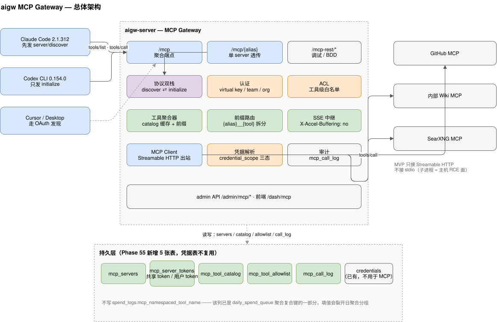
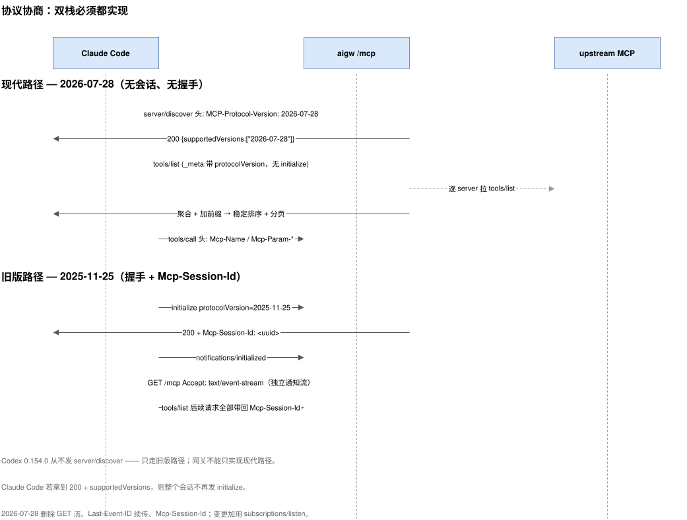
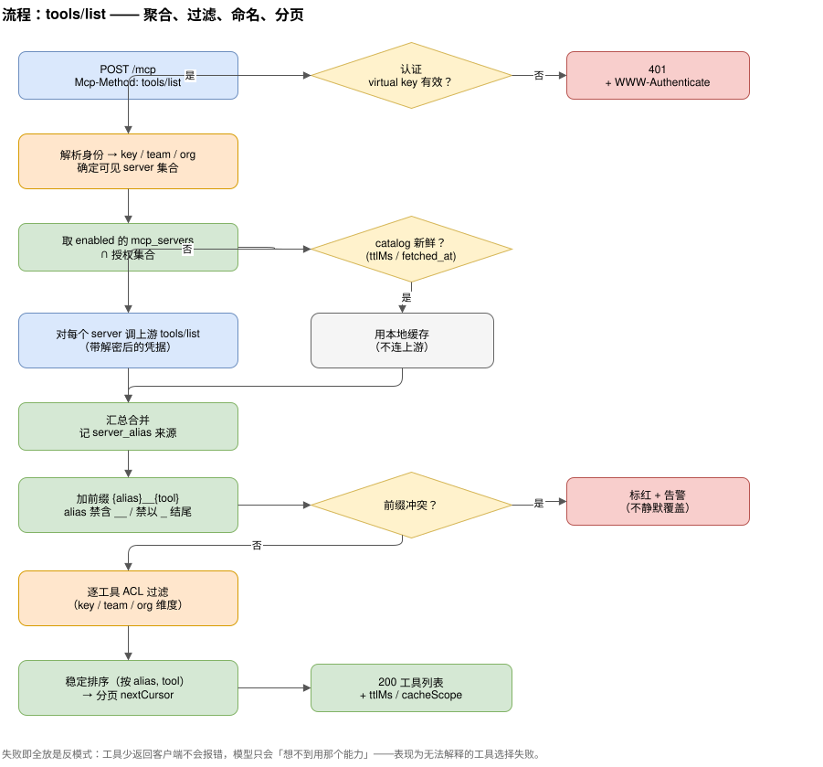
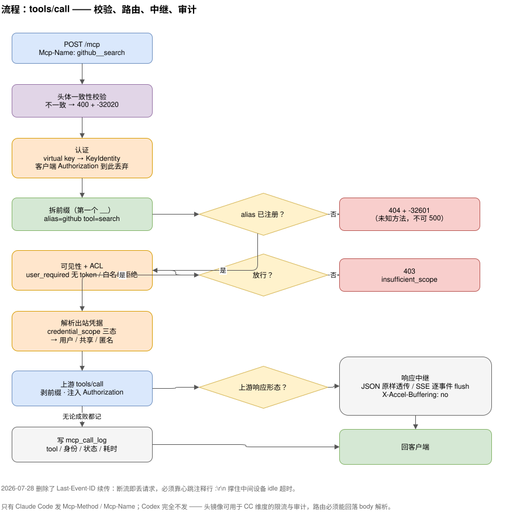
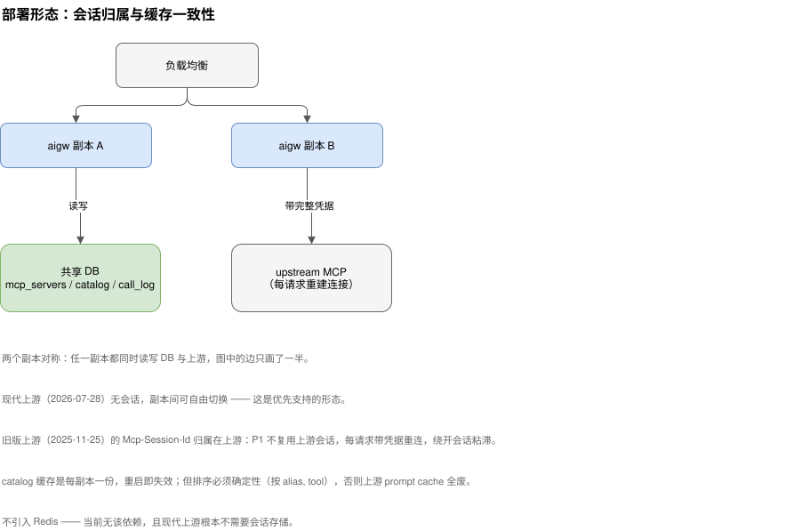
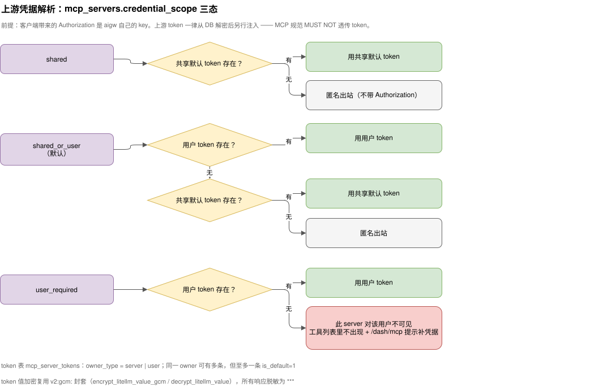

# aigw MCP Gateway 设计

> 规划日期: 2026-10-28
> 用途: 把 aigw 扩成 MCP 网关 —— agent 只连 aigw 一个端点，剩下的 server 纳管、工具聚合、凭据注入、工具级鉴权、调用审计都在网关内完成
> 依据: 2026-10-28 对 Claude Code 2.1.312 / Codex CLI 0.154.0 的**实测抓包**（自建探针 MCP server 捕获真实请求头与 body），而非仅读规范
> 规范基线: MCP `2026-07-28`（现代）+ `2025-11-25` / `2025-06-18`（旧版，必须同时支持）
> 状态: 设计已定（ADR-040），Phase 55 已规划（Stage 140-145），**未开工**
> 图表: `docs/diagrams/*.svg`，每个 SVG 都内嵌了 drawio 源（`content` 属性），直接用 draw.io 打开 SVG 即可编辑；同名的 `.drawio` 为可读源文件

---

## 1. 一句话目标

Claude Code 和 Codex 把 `aigw` 当成唯一的一个 MCP server 配置进去；aigw 在背后接 N 个真实 MCP server，对外提供统一的工具目录、统一的认证、统一的审计。

---

## 2. 实测结论（决定架构的五条硬事实）

这些不是推测，是探针 server 抓到的真实字节。

| # | 结论 | 证据 | 对设计的影响 |
|---|------|------|-------------|
| F1 | **Claude Code 是双栈**：先发 `server/discover`（`MCP-Protocol-Version: 2026-07-28`），拿到 `supportedVersions` 后整个会话不再发 `initialize` | 探针返回 `{"resultType":"complete","supportedVersions":["2026-07-28"],...}` 后，日志中 `initialize` 消失 | 必须实现 `server/discover`，返回值形状要对（`protocolVersion` 是标量而不是 `supportedVersions` 数组时，CC 会退回 `initialize`） |
| F2 | **Codex 0.154.0 是纯旧版**：只发 `initialize`，`protocolVersion` 为 `2025-06-18`，从不发 `server/discover`，也不发 `Mcp-Method`/`Mcp-Name` 头 | 探针日志全程无 `server/discover` | 只实现现代路径 = Codex 完全不可用。双栈是底线，不是加分项 |
| F3 | Claude Code 会把 `x-mcp-header` 注解的参数**镜像成请求头** `Mcp-Param-*` | 观察到 `mcp-param-region: us-west1`、`mcp-param-count: 7` | 网关可以据此做头维度的限流/审计；但**路由必须能回落解析 body**，因为 Codex 不发明这些头 |
| F4 | Claude Code 在 `tools/call` 上带 `Mcp-Name`，并遵循 `tools/list` 的 `nextCursor` 翻页 | 分页探针日志中两次 `tools/list`，第二次带 `cursor: cursor-page2` | 聚合器必须把多 server 的翻页抹平成一个稳定序列，否则 CC 拿不全工具 |
| F5 | Claude Code 靠 401 + `WWW-Authenticate: Bearer resource_metadata="..."` 自动发现 OAuth | 认证探针返回该头后，CC 依次请求 `/.well-known/oauth-protected-resource` 与 `/.well-known/oauth-authorization-server` | P3 做 OAuth 时，网关的 401 响应必须带这个头，否则 CC 不会尝试 OAuth |

另有一处与章程的冲突（**已解决**），和两条来自本仓库代码的既存缺陷（**已登记债务，不阻塞本 Phase**）：

- **`/v1/messages` 不转发客户端的 `anthropic-beta` 头**（`crates/aigw-server/src/routes/v1_messages.rs:901`，只构造 `x-api-key` 与 `anthropic-version`）→ **TD-021a**；OAuth 路径把 beta 串写死在 `crates/aigw-core/src/oauth_pipeline.rs:64` 且有两处写入点 → **TD-021b**。后果：Claude Code 的 tool search（`defer_loading` / `tool_reference`）后端能力被静默关掉，CC 2.1.305+ 在收到不识别的 400/422 后会**自动退回全量预加载工具**，用户看到的是「能用但很贵」，没有任何报错。**用户 2026-10-29 决策：单独修、排在 Phase 55 完成之后**，不阻塞 MCP 主线。
- ~~**`docs/01-charter.md:47` 把 MCP Server 管理列为 NG3**~~ —— 已由 **ADR-040**（2026-10-29 转 Accepted）改写为「MCP 协议能力扩展（resources / prompts / sampling / elicitation）永久跳过；MCP 网关本身进入范围」，章程已同步。

---

## 3. 总体架构



三个入口共用一套内核：

- **`/mcp`** —— 聚合端点。N 个上游 server 的工具合并成一份目录，工具名加前缀 `{alias}__{tool}` 消歧。
- **`/mcp/{alias}`** —— 单 server 透传。给「我就想直连 GitHub，不要别的」的场景用，也是 P1 的最小可用形态。
- **`/mcp-rest/*`** —— 无状态调试口（`tools/list`、`tools/call` 走普通 JSON POST），给 BDD 和 `curl` 用，不参与 agent 协议协商。

内核是四段流水线：**协议双栈 → 认证/ACL → 前缀路由 → 上游中继**，两侧各挂一个横切关注点（catalog 缓存、调用审计）。

前缀命名复用 aigw 已有的 `{ns}__{child}` 约定（Stage 131 的 namespaced tool name），符合 SEP-986 的 `A-Za-z0-9_.-`、1–128 字符限制。约束：`alias` 不得含 `__`，不得以下划线结尾，否则前缀会被贪心拆分拆错。

**MVP 不做 stdio**。stdio 等于让网关在本机起子进程执行任意命令，是主机 RCE 面，而 aigw 的部署形态是共享网关。只接 Streamable HTTP（含旧版 HTTP+SSE 上游，按 `Accept` 协商）。

---

## 4. 协议协商流程



网关对客户端是**双栈服务端**，对上游是**双栈客户端**，两侧独立协商 —— 客户端走现代、上游只能旧版，是完全正常的组合，网关负责转换。

现代路径（2026-07-28）的关键差异，决定了实现复杂度：

| 2026-07-28 的变化 | 实现含义 |
|---|---|
| 删除协议级会话与 `Mcp-Session-Id` | 网关进程可以被无状态地调度，水平扩展不需要粘性会话 |
| 删除 `initialize` 握手，改用 `server/discover` | 能力探测变成一次普通请求，可缓存（`ttlMs` / `cacheScope`） |
| 强制 `Mcp-Method` / `Mcp-Name` 请求头 | 可以在读 body 之前就做路由与限流；但必须容忍缺失（Codex 不发） |
| `x-mcp-header` 改名 `Mcp-Param-*` | 上游若是新版，需要把注解参数搬到头上 |
| 删除 `Last-Event-ID` 续传 | 流断了就是丢了，不能靠重连续传；必须主动发 SSE 注释行心跳（`:\r\n`）压住中间设备的 idle 超时 |

旧版路径（2025-11-25 / 2025-06-18）保留 `initialize` → `Mcp-Session-Id` → `GET` 独立通知流三步。`GET /mcp` 在现代协议下应答 **405**（规范要求），在旧版协议下才开 SSE 流。

---

## 5. `tools/list` 流程



几个容易做错的地方：

- **`alias` 与 `tool` 之间用 `__` 分隔后必须能被可靠还原**。上游工具名本身可能含 `_`，所以拆分只能找**第一个** `__`，并且注册时就要拒绝含 `__` 的 alias。
- **前缀冲突不能静默覆盖**。两个 server 提供同名工具是常态，覆盖会让模型看到的名字指向错误实现，排查成本极高。标红 + 告警，让人去改 alias。
- **排序必须确定性**（按 `alias, tool`）。规范是 SHOULD，但它是**上游 prompt cache 的前提**：工具列表顺序抖动一次，整个缓存前缀作废。
- **ACL 拒绝只封调用，不从列表里删**。给多了（看见了调不动）会浪费一轮模型 + 一个报错；但把工具从列表里藏掉，等于隐藏了「管理员禁止了你」这一事实 —— 用户会以为上游没提供这个工具，反而更糟。所以列表照给、调用 403 + `insufficient_scope`。
- **反过来，`user_required` 无 token 时列表侧静默剔除**。那里藏掉的是「你还没配 token」—— 一个用户可自行解决的状态，且藏掉后调也调不到（会 403），没必要先给再拒。两种处理对应两种不同的事实，不是不一致。
- **catalog 缓存按 `ttlMs` 过期**。上游 `server/discover` 返回的 `ttlMs` 是权威值，没给就取默认。缓存命中时完全不连上游，这是网关的核心性能收益。

---

## 6. `tools/call` 流程



要点：

- **认证之后立刻丢弃客户端 `Authorization`**。它只是 aigw 的 virtual key，解析出 `KeyIdentity` 后就没有用处；出站凭据由 `credential_scope` 另行解析（§8）。图里把「认证」与「解析出站凭据」分成两个框，就是为了让这条边界看得见。
- **可见性与 ACL 在解析凭据之前判**。`user_required` 且用户无 token、或白名单拒绝时，连上游都不该连 —— 先判再解析，避免为了一个注定 403 的请求解密 token。
- **头体一致性校验**。`Mcp-Name` 与 body 里的 `params.name` 不一致时返回 400 + `-32020`，不要猜哪个是真的 —— 这是一致性攻击面，也是上游 server 的 RFC 9421 签名验证失败源。
- **未知方法返回 `-32601` 而不是 500**。Claude Code 遇到 500 会重试，遇到 `-32601` 会走降级。
- **SSE 透传必须逐事件 flush**，并带 `X-Accel-Buffering: no`（否则 nginx 会缓冲整条流，工具调用看起来像卡死）。2026-07-28 删了续传，所以心跳是唯一护栏。
- **审计无论成败都写**。失败的调用才是排障的主要输入，只记成功等于没有审计。

---

## 7. 部署形态与会话归属



这是最容易在上线当天炸的地方：

- **现代上游无会话** → 网关副本可自由切换，负载均衡随便配。
- **旧版上游有 `Mcp-Session-Id`** → 会话归属在**上游**，而 aigw 的副本会轮换。若网关缓存了上游 session 而请求被路由到另一个副本，session 就找不到了。
- **缓解**：要么 LB 按 `Mcp-Session-Id` 一致性哈希，要么在 P1 阶段干脆**不做上游会话复用**（每次请求带完整凭据重连，旧版上游也能接受）。不引入 Redis —— 项目当前没有这个依赖，为一个可能用不上的场景加基础设施违反奥卡姆剃刀。

catalog 缓存是每副本一份，重启即失效。这没问题，但**排序确定性**是硬约束（见 §5）。

---

## 8. 上游凭据（aigw → MCP server）



**方向先钉死**：客户端带来的 `Authorization: Bearer <aigw key>` 是 **aigw 自己的 virtual key**，只在 aigw 边界内有效。MCP 规范对网关有明确要求 —— **MUST NOT** 把客户端凭据透传给上游。所以：

- 客户端 `Authorization` 只用于认证与身份解析（`KeyIdentity`），解析完即丢弃，**绝不转发**；
- 出站到上游的 `Authorization` **只**来自 `mcp_server_tokens` 解密结果；
- 两者不是同一个东西，也不存在「客户端 token 顺便借给上游用」这条路径。

### 8.1 `credential_scope` 三态

管理员注册 server 时选一档，决定「出站时用谁的 token」：

| 值 | 解析行为 | 适用场景 |
|---|---|---|
| `shared` | 只用 server 级共享默认 token；没有就匿名出站（不带 `Authorization`） | 内部 Wiki 这类全网关共用一个服务账号 |
| `shared_or_user`（**默认**） | 该用户自己的 token 优先 → 回落 server 级共享默认 token → 都没有则匿名出站 | GitHub 这类「管理员放一个公用 token 兜底，愿意用个人身份的人可以自己填」 |
| `user_required` | 只有用户 token；没有则该 server 对本次请求不可见 | 权限严格按人区分的上游 |

三者都是**解析行为**的差异，不是不同的表。

### 8.2 `mcp_server_tokens`

| 字段 | 说明 |
|---|---|
| `id` | 主键 |
| `server_id` | → `mcp_servers(id)` `ON DELETE CASCADE` |
| `owner_type` | `server` / `user` |
| `owner_id` | `owner_type=server` 时为空串；`user` 时为 `user_id` |
| `token_name` | 便于轮换时辨识，如 `svc-account-2026` |
| `token_value` | 加密值，`v2:gcm:` 封套（`encrypt_litellm_value_gcm` / `decrypt_litellm_value`） |
| `is_default` | 同一 `(server_id, owner_type, owner_id)` 至多一条为 1 |
| `enabled` | 停用而不删除，便于回滚 |
| `expires_at` | 可空，过期后视同不存在 |

唯一约束：`(server_id, owner_type, owner_id, token_name)`。

「至多一条 `is_default=1`」在 SQLite / PostgreSQL 用部分唯一索引表达；**MySQL 没有部分唯一索引**，只能靠应用层事务（同 owner 内先全部清零再置 1）保证 —— 这与仓库里 `is_default` 类字段的既有处理方式一致。

### 8.3 解析顺序

```text
resolve(server, identity):
  match server.credential_scope:
    shared         => default_token(server, owner=server)
    shared_or_user => user_token(server, identity.user_id) ?? default_token(server, owner=server)
    user_required  => user_token(server, identity.user_id)
  # 返回 None 即「没有可用 token」
```

`identity.user_id` 来自 `KeyIdentity`；master key 或未绑定用户的 key 为 `None`，user 级查询直接落空。

**`user_required` 且无 token 时，列表侧静默、调用侧报错**：

- `tools/list` —— 该 server 的全部工具**不出现**在合并目录里，不报错。模型看不见就不会调，这是对的；
- `tools/call` —— 显式点名了却无凭据，返回 403 + `insufficient_scope`，错误消息带 `server` 与「需配置个人 token」。用户主动要的东西必须给明确原因。

给多了（看见了调不动）比给少了（看不见）更糟：前者浪费一轮模型 + 一个报错，后者只是「想不到」。

### 8.4 安全约束

- token 明文**永不出现在任何响应**里，一律 `***`（与 `ProxyResponse` 脱敏 `proxy_url` 同一思路）；
- 解密只在出站前做一次，**不进 catalog 缓存、不进日志、不进 `mcp_call_log`**；
- 用户级 token 的写入/删除只能由**本人或 admin** 操作；admin 可读元数据（名称、是否已设置、更新时间），**不可读明文**；
- 轮换靠 `is_default` 切换，旧值留 `enabled=0`。

### 8.5 为什么不复用已有的 `credentials` 表

`credentials` 是网关级的加密键值桶（LLM provider key、`proxy_url` 那类），**没有 owner 维度**。用户级 MCP token 天然是 per-user 的，塞进去要么拼 key 名（`mcp:github:user:u_123`）要么加列，两条路都比新表脏。

结论：**复用加密函数，不复用表**。

---

## 9. 接口清单

### 9.1 面向 agent 的端点

| 方法 | 路径 | 说明 |
|---|---|---|
| `POST` | `/mcp` | 聚合端点，唯一推荐给 agent 的入口 |
| `GET` | `/mcp` | 旧版协议：SSE 通知流；现代协议：405 |
| `DELETE` | `/mcp` | 旧版协议：终止会话；现代协议：405 |
| `POST` | `/mcp/{alias}` | 单 server 透传，不做前缀加壳 |
| `GET` | `/.well-known/oauth-protected-resource` | RFC 9728 保护资源元数据（P3） |
| `GET` | `/.well-known/oauth-authorization-server` | RFC 8414 授权服务器元数据（P3，仅当 aigw 自任 AS） |

### 9.2 调试端点

| 方法 | 路径 | 说明 |
|---|---|---|
| `POST` | `/mcp-rest/tools/list` | 无状态工具列表，`{alias}` 可选过滤 |
| `POST` | `/mcp-rest/tools/call` | 无状态工具调用 |
| `GET` | `/mcp-rest/health` | 上游可达性探针 |

无状态口**不走协议协商**，直接 JSON 进 JSON 出。存在的意义是让 BDD 不必模拟双栈握手，也让运维能 `curl` 定位问题。生产可以按配置关闭。

### 9.3 管理端点 `/admin/mcp/*`

对齐 `websearch` / `proxies` 的既有 REST 风格：

| 方法 | 路径 | 说明 |
|---|---|---|
| `GET` | `/admin/mcp/servers` | 分页列表（`status` / `search` 过滤） |
| `GET` | `/admin/mcp/servers/all` | 全部（下拉框用） |
| `POST` | `/admin/mcp/servers` | 新建 |
| `GET`/`PUT`/`DELETE` | `/admin/mcp/servers/{id}` | 详情 / 更新 / 删除 |
| `POST` | `/admin/mcp/servers/batch-delete` | 批量删除 |
| `POST` | `/admin/mcp/servers/{id}/toggle` | 启停（`enabled` 翻转） |
| `POST` | `/admin/mcp/servers/{id}/probe` | 探测：拉 `server/discover` + `tools/list`，写回 catalog 快照 |
| `GET` | `/admin/mcp/servers/{id}/tools` | 该 server 的 catalog 与冲突标记 |
| `PUT` | `/admin/mcp/servers/{id}/allowlist` | 工具级白名单（按 key / team / org） |
| `GET` | `/admin/mcp/servers/{id}/tokens` | 该 server 的 token 元数据（`***` 脱敏，管理员含 server 级 + 全部 user 级） |
| `POST` | `/admin/mcp/servers/{id}/tokens` | 新增 token（`owner_type=server` 仅 admin；`owner_type=user` admin 可代建） |
| `DELETE` | `/admin/mcp/servers/{id}/tokens/{token_id}` | 删除 token |
| `POST` | `/admin/mcp/servers/{id}/tokens/{token_id}/default` | 置为该 owner 的默认 token |
| `GET` | `/admin/mcp/calls` | 调用日志（分页、按 server / tool / 状态过滤） |
| `POST` | `/admin/mcp/reload` | 清空 catalog 缓存并重新探测 |

用户自助管理个人 token 走另一组路径。**不是「同一套处理器换个入口」** —— 那组 handler 的身份只从 `KeyIdentity` 取、签名里根本没有 `owner_id`，从根上没有越权代填的注入点：

| 方法 | 路径 | 说明 |
|---|---|---|
| `GET` | `/v1/mcp/servers` | 当前身份可见的 server 列表 + 各自「是否已配个人 token / 是否必需」 |
| `GET`/`PUT`/`DELETE` | `/v1/mcp/servers/{id}/my-token` | 我的 token：查询元数据 / 设置 / 删除 |

鉴权沿用 aigw 现有 admin 中间件，不新造。`/v1/mcp/*` 走 virtual key 认证，与 `/v1/messages` 同一条中间件链。

---

## 10. 数据模型

新增五张表。加密函数复用已有实现（`encrypt_litellm_value_gcm` / `decrypt_litellm_value`），**表不复用**（理由见 §8.5）。

| 表 | 关键字段 | 说明 |
|---|---|---|
| `mcp_servers` | `id`、`alias`（唯一，禁 `__`）、`display_name`、`url`、`transport`、`credential_scope`（`shared`/`shared_or_user`/`user_required`）、`enabled`、`protocol_version`、`created_at`/`updated_at` | 上游 server 注册表 |
| `mcp_server_tokens` | `id`、`server_id`、`owner_type`（`server`/`user`）、`owner_id`、`token_name`、`token_value`（`v2:gcm:`）、`is_default`、`enabled`、`expires_at`、`created_by`、`created_at`/`updated_at` | 上游凭据，见 §8.2 |
| `mcp_tool_catalog` | `server_id`、`tool_name`、`description`、`input_schema`（JSON）、`annotations`（JSON）、`has_conflict`、`fetched_at` | 探测快照，兼作缓存持久层 |
| `mcp_tool_allowlist` | `server_id`、`tool_name`、`scope_type`（key/team/org）、`scope_id`、`allowed` | 工具级 ACL，行不存在 = 不限制 |
| `mcp_call_log` | `call_id`、`server_alias`、`tool_name`、`key_id`、`user_id`、`token_owner`（`server`/`user`/`anonymous`）、`status`、`error_code`、`latency_ms`、`request_bytes`、`response_bytes`、`created_at` | 调用审计；`token_owner` 回答「这次是谁的身份」 |

迁移文件按**消费者同批**拆成四份（`029_mcp_gateway.sql` / `030_mcp_tool_catalog.sql` / `031_mcp_call_log.sql` / `032_mcp_tool_allowlist.sql`，Stage 140 / 141 / 143 / 144 各一份），三方言（`sqlite/`、`postgres/`、`mysql/`）各一套。表在没有任何代码写它的时候就存在，是最容易长出「没人知道这列干嘛」的地方。**MySQL 的 `idx_*` 索引名长度 ≤ 128**；JSON 列在**迁移文件里**就是普通 `JSON` 类型声明，Rust 侧绑 `serde_json::Value` 由 sqlx 原生编解码 —— `CAST(CAST(X'hex' AS CHAR) AS JSON)` 是 `aigw-migrate/src/native.rs:1267` 为了让 py 侧字符串安全转 SQL 字面量才用的，**仅适用于迁移文件里的裸 SQL 字面量**；正常 store 路径绑 `serde_json::Value` 由 sqlx 原生编解码，不需要它。

`is_default` 的部分唯一索引：SQLite 用 `WHERE is_default = 1`；**PostgreSQL 必须写 `WHERE is_default`** —— PG 没有 boolean = integer 运算符，而该列是 `BOOLEAN`（写成 `INTEGER` 则 sqlx 解不进 Rust `bool`）。MySQL 无部分索引能力，退化为应用层事务保证（同 owner 内先清零再置 1）；三方言的 `set_default_mcp_token` **统一走事务**，部分索引只作兜底约束（ADR-041）。

**不写 `spend_logs.mcp_namespaced_tool_name`。** 该列已经是 `daily_spend_queue` 聚合复合键的一部分（见 `docs/11-next-steps.md:280`），MCP 调用填值会把日聚合分组打散。MCP 的账走 `mcp_call_log`，与 LLM 用量解耦。

---

## 11. 前端规划

新增 `/dash/mcp`，直接照抄 `crates/aigw-frontend/src/pages/websearch/index.tsx` 的结构（`@tanstack/react-query` + `@/components/ui/*` + `sonner`），不发明新范式。

```
/dash/mcp
├── 页头        新建 server · 全部重新探测
├── 筛选行      状态（全部/启用/停用）· 搜索（alias/显示名）
└── 表格        alias | 显示名 | URL | 协议版本 | 工具数 | 凭据模式 | 状态 | 操作
                  操作: 编辑 / 探测 / 工具列表 / 凭据 / 白名单 / 启停 / 删除
```

五个子对话框：

- **`ServerDialog`** —— 新建/编辑。`alias` 实时校验（禁 `__`、禁下划线结尾、唯一性）；URL 填完可点「探测」验证连通性；`credential_scope` 三选一（带一句人话解释）。
- **`ProbeDialog`** —— 展示探测结果：协商到的协议版本、`serverInfo`、`ttlMs`、工具数量、**冲突工具标红**。
- **`TokenDialog`** —— 共享 token 管理。列表只显示 `token_name` / 是否默认 / 更新时间，值恒为 `***`；「设为默认」是行内操作；新建时输入明文，提交后不再回显。
- **`ToolsDialog`** —— 该 server 的工具清单，支持单个工具的白名单开关（按 key/team/org 维度）。
- **`CallLogDialog`** —— 调用日志，按时间倒序，失败高亮，显示本次用的是 `server` / `user` / `anonymous` 身份。

另加一块 **「我的 MCP 凭据」**：`/dash/mcp` 顶部一个 tab，普通用户只看到这个 tab（无 admin 权限时隐藏 server 管理）。表格列 `server | 凭据模式 | 我的 token | 操作`，`user_required` 且未配置的行标黄 + 提示「未配置则此 server 的工具对你不开放」。

再加一个 **Playground 复用**：在 `/dash/playground` 里加 MCP 标签页，能直接对 `/mcp-rest/tools/call` 发调用并看原始 SSE 流 —— 这是排查「模型说没这个工具」的最快路径。

i18n 新增 `mcp` 命名空间，en / zh-CN 双语，与既有模块一致。

---

## 12. Agent 接入方式

### 12.1 Claude Code

```bash
# 聚合端点（推荐）
claude mcp add --transport http aigw https://aigw.example.com/mcp \
  --header "Authorization: Bearer $AIGW_KEY"

# 单 server
claude mcp add --transport http github https://aigw.example.com/mcp/github \
  --header "Authorization: Bearer $AIGW_KEY"
```

或写 `.mcp.json`：

```json
{
  "mcpServers": {
    "aigw": {
      "type": "http",
      "url": "https://aigw.example.com/mcp",
      "headers": { "Authorization": "Bearer ${AIGW_KEY}" }
    }
  }
}
```

CC 会先发 `server/discover`；网关返回 `supportedVersions: ["2026-07-28"]` 即进入无会话模式。

**工具数量提示**：CC 有工具搜索（`ENABLE_TOOL_SEARCH`，默认阈值 10%）。上游工具总数超过阈值时 CC 会自动把工具标为 `defer_loading`，只用 `tool_search` 拉相关子集。这要求 aigw 的 `/v1/messages` **转发 `anthropic-beta`**（见 §2 的两条既存缺陷，TD-021a / TD-021b，**排在 Phase 55 之后修**），否则该能力静默失效 —— 也就是说 Phase 55 上线后、修掉 TD-021 之前，工具越多越贵。

### 12.2 Codex CLI

Codex 的 `bearer_token` **必须**用环境变量形式，不支持内联明文；CLI 也没有 `--header` 参数，只能改 TOML：

```toml
[mcp_servers.aigw]
url = "https://aigw.example.com/mcp"
bearer_token_env_var = "AIGW_KEY"
```

Codex 只走 `initialize`（`2025-06-18`），网关必须为它保留旧版路径与 `Mcp-Session-Id` 语义。

---

## 13. 分期

| 期 | 内容 | 对应 Stage | 依赖 | 交付判据 |
|---|---|---|---|---|
| **P1** | 数据层 + admin CRUD + 探测 + 前端管理页 + `/mcp/{alias}` 单 server 透传 + 共享 token | 140 / 141 / 142 / 143 | 无 | CC 与 Codex 都能通过 `aigw` 调通一个真实上游 |
| **P2** | `/mcp` 聚合端点 + `{alias}__{tool}` 前缀 + 工具级 ACL + 用户级 token + 「我的凭据」页 | 144 / 145 | P1 | 两个上游合并成一个目录，冲突可见，越权调用被 403，用户补 token 后由不可见变可见 |
| **P3** | `/.well-known/oauth-protected-resource` + AS 发现 + `WWW-Authenticate` 引导 | 未立项（Phase 57） | P2 | CC 能零配置完成 OAuth 授权 |

Stage 级拆分与前后端分工见 `docs/stages/stage-roadmap.md` 的 Phase 55 一节。

**原 P0（`anthropic-beta` 透传）已剥离** —— 用户 2026-10-29 决策改为**独立修复、排在 Phase 55 之后**，登记为 TD-021a / TD-021b。它不阻塞任何 MCP Stage，只是「不修的话工具一多就贵」。

不排 stdio，除非有人能给出「必须在本机起子进程」的硬需求。

---

## 14. 待决事项

| # | 问题 | 选项 | 建议 |
|---|---|---|---|
| D1 | `/mcp` 聚合端点是否默认开启 | 默认开 / 默认关只给 `/mcp/{alias}` | **默认开**。聚合才是网关的价值所在；单 server 透传只是过渡形态 |
| D2 | catalog 缓存放哪 | 进程内存 / DB 表 / 二者兼有 | **已定（ADR-041）：内存为主 + `mcp_tool_catalog` 做持久快照**。DB 是探测结果的事实来源，内存是热路径。内存那份是 `aigw-core/src/mcp/catalog_cache.rs` 的进程级静态，**不挂 `AppState`** —— 每副本一份、重启即失效（§7），不需要按实例注入 |
| D3 | 上游凭据粒度 | 全网关一个共享 token / 支持用户自带 token | **已定：三态 `credential_scope`（§8.1）**。P1 先做 `shared`，P2 补齐 user 级 |
| D4 | 用户 token 与 virtual key 谁绑定 | 绑 `user_id` / 绑 `key_id` | **绑 `user_id`**。一个人可能有多把 key，绑 key 会让用户每换一把 key 就重填一次 token；`KeyIdentity.user_id` 已现成 |
| D5 | 用户 token 过期后怎么办 | 静默失效 / 主动提醒 | **列表侧降级为不可见，UI 标黄提醒**。不做过期前邮件推送 —— 没有通知基础设施，加一个只为这件事是过度设计 |

---

## 15. 与章程的冲突

`docs/01-charter.md:47` **改写前**写着：

> `| NG3 | MCP Server 管理 | 长期路线 Phase 3 | 不是当前使用场景 |`

**ADR-040（2026-10-29 用户批准，Status: Accepted）已把它改写为**：

> `| NG3 | MCP 协议能力扩展（resources / prompts / sampling / elicitation） | 永久跳过 | 只做 tools 原语；MCP 网关本身已进入范围（Phase 55，ADR-040） |`

即：**MCP 网关本身进入范围，但只做 `tools` 原语**。这一刀切得干净，也符合「网关的价值在工具聚合与治理」这一判断。章程（`docs/01-charter.md`）已同步，Phase 55 可正常立项推进。
